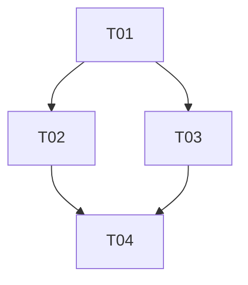

# Ticket Layouts

`egm-tickets` uses three layouts: the draft (one file, reviewed by the
Goldfish), each final ticket file, and the final index. Replace text in
square brackets. Remove the HTML comments.

--------------------------------------------------------------------------------

## 1. Draft: `tickets_draft.md`

````markdown
# Tickets: [Feature Name]

*   **Design:** [relative path to the design document]
*   **Design status:** [Approved | other status chosen at Step 1]
*   **Slicing strategy:** [strategy chosen at Step 3, in one line]
*   **Date:** [YYYY-MM-DD]

## Plan Inventory

| Id | Type | Item | Source |
| :- | :--- | :--- | :----- |
| F1 | File (Modify) | `src/webhooks/dispatcher.py` | Detailed Implementation Plan, item 1 |
| C1 | CUJ | Retry a failed delivery | CUJ 1 |
| V1 | Verification | `pytest tests/webhooks` | Verification Plan |
| G1 | Goal | Deliver each event at least once | Goals |

## T01: [Imperative title, under 70 characters]

[Ticket body: every section of layout 2 below, from `**Summary**` to
`**Out of scope**`, with the frontmatter fields written as a list:]

*   **Depends on:** [none | T0x, T0y]
*   **Covers:** [F1, F2, C1, V1]
*   **Size:** [S | M | L]

[... one H2 section per ticket ...]

## Coverage Matrix

| Id | Tickets |
| :- | :------ |
| F1 | T01 |
| F2 | T01 (owner), T03 (shared: adds one enum value) |
| C1 | T01, T02 |
| G1 | T02 |

## Dependency Graph



## Design Updates Needed

<!-- Decisions made at the Design Gap Gate. Write "None" if empty. -->

*   [T03] Decided during ticket breakdown: [decision]. Add to [design section].

## Checks

*   Coverage of F, C, V ids: pass
*   Single owner per file: pass
*   Files inside Target Files: pass
*   Dependencies valid and acyclic: pass
*   All sections filled: pass
````

--------------------------------------------------------------------------------

## 2. Ticket file: `T<NN>-<slug>.md`

`<slug>` is the title in lower case, words joined by `-`, at most six words.

````markdown
---
id: T01
title: [Imperative title]
status: todo
size: [S | M | L]
depends_on: []
covers: [F1, F2, C1, V1]
design: [relative path to the design document]
design_status: [Approved | other]
---

# T01: [Imperative title]

**Summary**

[One or two sentences: what this ticket delivers.]

**Context**

[Two to five sentences: why this ticket exists, what earlier tickets already
provide, and a link to the design section. Name any open question or
"Decided during ticket breakdown" item here.]

**Files**

| File | Action | Inventory | Note |
| :--- | :----- | :-------- | :--- |
| `src/webhooks/dispatcher.py` | Modify | F1 | owner |
| `src/webhooks/models.py` | Modify | F2 | shared: adds `DeliveryState.RETRYING` only |

Change only the files in this table.

**Changes**

1.  `src/webhooks/dispatcher.py`: [exact change from the design: function or
    class names, signatures, fields, error handling, as the design states
    them]. Source: [link to design section].
2.  [...]

**Acceptance Criteria**

*   **Given** [state], **When** [action], **Then** [checkable result].
*   [...]

**Verification**

*   [Exact command, for example `pytest tests/webhooks/test_dispatcher.py`]
*   New tests: [test names or cases this ticket must add]

**Out of scope**

*   [What a reader might expect here but belongs to another ticket] (T03)
````

--------------------------------------------------------------------------------

## 3. Index: `README.md`

````markdown
# Tickets: [Feature Name]

*   **Design:** [link to the design document]
*   **Design status:** [status]
*   **Slicing strategy:** [one line]
*   **Review:** [converged after N rounds | accepted with open findings, see report | skipped by author | not run]
*   **Generated:** [YYYY-MM-DD] by `egm-tickets`

| Id | Title | Size | Depends on | Status |
| :- | :---- | :--- | :--------- | :----- |
| [T01](T01-add-delivery-state.md) | Add delivery state | S | none | todo |
| [T02](T02-retry-failed-delivery.md) | Retry failed delivery | M | T01 | todo |

## Dependency Graph

[Copy the Mermaid graph from the draft.]

## Coverage Matrix

[Copy the table from the draft.]

## Design Updates Needed

[Copy the list from the draft, or "None".]
````
